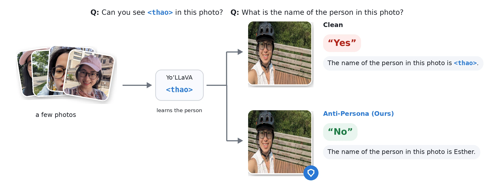
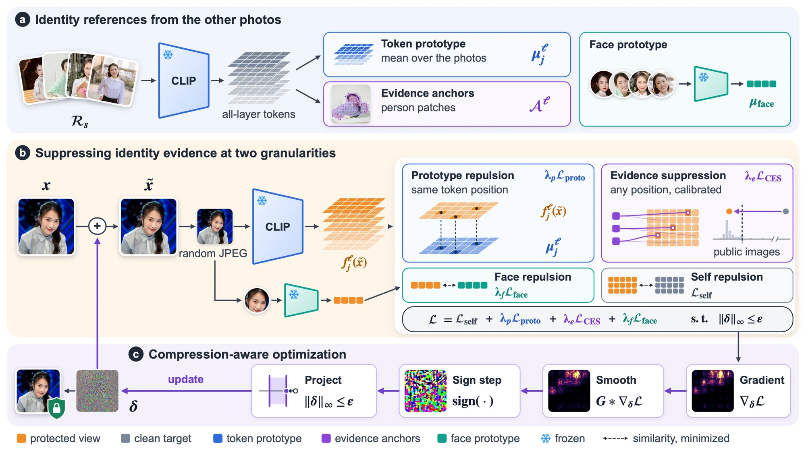

<div align="center">



<h1>Anti-Persona</h1>
<h3>Disrupting Unauthorized Identity Binding and Recognition in Personalized Vision–Language Models</h3>

[**Abhishek Basu**](#)<sup>1\*</sup> · [**Fahad Shamshad**](#)<sup>1\*</sup> · [**Karthik Nandakumar**](#)<sup>1,2</sup>

<sup>1</sup>MBZUAI &nbsp;&nbsp; <sup>2</sup>Michigan State University &nbsp;&nbsp; 

<a href="https://abasu.ai/anti-persona/"></a>
<a href="LICENSE"></a>

</div>

## 🔥 News

- **2026-11** Code of the method and the evaluation is released.
- **Coming soon:** the paper, the benchmark, the checkpoints and the baselines.

## TL;DR

Personalized LVLMs such as **Yo'LLaVA** and **MyVLM** learn who someone is from a handful of photos and can then find
that person in any image with a simple question. **Anti-Persona** adds an imperceptible perturbation (ℓ∞ ≤ 4/255) to
a photo so that a personalized model can neither **learn** the person from it (*proactive*) nor **recognize** the
person in it (*reactive*). It pushes the photo away from **identity prototypes** built from the person's other photos
(in the vision encoder and in face space) and suppresses the remaining identity evidence with **Calibrated Evidence
Suppression (CES)**.

<p align="center"></p>

## 📈 Results

Protection rate on 25 identities (165 test photos): % of all test photos the personalized model does **not** recognize (↑), mean ± std over
two seeds. Every baseline gets the same face loss as ours for a fair comparison. Full tables in
[docs/RESULTS.md](docs/RESULTS.md).

| Setting | **Anti-Persona** | Best baseline (+ face) |
|---|:---:|:---:|
| Reactive · Yo'LLaVA | **92.1 ± 1.8** | 80.6 (I-FGSM) |
| Reactive · MyVLM | **94.8 ± 0.9** | 84.8 (GLEAM) |
| Proactive · MyVLM | **84.5 ± 0.3** | 71.2 (GLEAM) |
| Black-box · Yo'LLaVA | **74.0 ± 0.4** | 51.1 (GLEAM) |
| JPEG Q85 · Yo'LLaVA | **78.5 ± 2.1** | 49.1 (GLEAM) |

Image quality: **38.8 dB PSNR**, SSIM 0.945, LPIPS 0.056.

## 🚀 Quickstart

```bash
git clone https://github.com/iabh1shekbasu/anti-persona && cd anti-persona
pip install -r requirements.txt                # Python 3.10, PyTorch 2.1 (CUDA or ROCm)
python scripts/download_weights.py             # CLIP ViT-L/14-336, DeepLabV3, buffalo_l (sha256-checked)
python scripts/download_coco100.py             # 100 COCO photos for calibration

# protect every photo of one person (a folder with ≥ 2 photos of the same person)
python -m anti_persona.protect --album my_photos/ --out protected/
```

Each photo is protected using the person's other photos as references. One photo takes about a minute on one GPU
(3.7 GB). Reproducing the paper (victims, evaluation, JPEG, VQA):
[docs/REPRODUCE.md](docs/REPRODUCE.md).

## 🗂️ Benchmark and checkpoints

Coming soon.

## 📁 Repository

| | |
|---|---|
| [`anti_persona/`](anti_persona/) | the method: prototypes, CES, face term, optimization, CLI |
| [`eval/`](eval/) | evaluation: proactive and reactive, on Yo'LLaVA and MyVLM |
| [`configs/final.yaml`](configs/final.yaml) | every hyper-parameter |
| [`victims/`](victims/) | vendored Yo'LLaVA and MyVLM |
| [`tests/`](tests/) | equivalence test against the code behind the paper |

## 📖 Citation

```bibtex
@misc{basu2026antipersona,
  title         = {Anti-Persona: Disrupting Unauthorized Identity Binding and Recognition in Personalized Vision--Language Models},
  author        = {Basu, Abhishek and Shamshad, Fahad and Nandakumar, Karthik},
  year          = {2026}
}
```

## 🙏 Acknowledgement & License

Built on [Yo'LLaVA](https://github.com/WisconsinAIVision/YoLLaVA), [MyVLM](https://github.com/snap-research/MyVLM),
[LLaVA](https://github.com/haotian-liu/LLaVA), [OpenCLIP](https://github.com/mlfoundations/open_clip) and
[insightface](https://github.com/deepinsight/insightface).

Our code is [MIT](LICENSE). `victims/yollava/` is Apache-2.0; `victims/myvlm/` is under Snap's **non-commercial**
license; downloaded models keep their own licenses (insightface: non-commercial research). See
[licenses/THIRD_PARTY_NOTICES.md](licenses/THIRD_PARTY_NOTICES.md).
